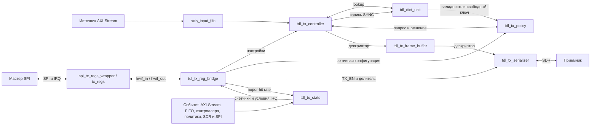

# tdl_tx_top

## Назначение

Верхний уровень передатчика TDL принимает 32-битные слова от источника AXI-Stream, выполняет точную дедупликацию и передаёт результат по однобитному SDR. SPI даёт доступ к настройкам, диагностике и счётчикам. После попадания в словарь передаётся ключ, после вставки или замены — ключ с исходным словом. В Bypass и при отказе политики в допуске передаётся исходное слово.

`tdl_tx_top` соединяет блоки. Хранилище владеет физическими строками словаря, политика ведёт метаданные, контроллер формирует дескриптор, а очередь кадров и сериализатор сохраняют порядок передачи.

## Порты

### Параметры

| Параметр | По умолчанию | Назначение |
| --- | --- | --- |
| `DATA_WIDTH` | 32 | Ширина входного слова. Базовый формат кадров рассчитан на 32 бита. |
| `FIFO_DEPTH` | 16 | Число слов во входном FIFO. Степень двойки, минимум 2. |
| `DICT_SIZE` | 256 | Число физических строк словаря, от 2 до 256. |
| `KEY_WIDTH` | `$clog2(DICT_SIZE)` | Локальная ширина ключа словаря. В дескрипторе и на линии ключ занимает 8 бит. |

### Системный интерфейс и AXI-Stream

| Порт | Направление | Ширина или тип | Назначение |
| --- | --- | --- | --- |
| `clk` | Вход | 1 | Общий такт внутреннего тракта, статистики и CSR. |
| `rst_n` | Вход | 1 | Общий активный низкий сброс. |
| `s_axis_tdata` | Вход | `DATA_WIDTH` | Исходное слово. |
| `s_axis_tvalid` | Вход | 1 | Источник выставил действительное слово. |
| `s_axis_tready` | Выход | 1 | Во входном FIFO есть место. |
| `s_axis_tlast` | Вход | 1 | Граница AXI-Stream пакета. Порт сохранён, базовый формат кодирует каждое слово самостоятельно. |

### SDR и SPI

| Порт | Направление | Ширина или тип | Назначение |
| --- | --- | --- | --- |
| `sdr_data` | Выход | 1 | Текущий бит кадра. |
| `sdr_clk` | Выход | 1 | Зарегистрированный такт SDR, приёмник считывает бит на подъёме. |
| `sdr_ready` | Вход | 1 | Синхронное к `clk` разрешение следующего подъёма SDR. |
| `spi_sclk` | Вход | 1 | Такт мастера SPI mode 0. |
| `spi_cs_n` | Вход | 1 | Активный низкий выбор устройства SPI. |
| `spi_mosi` | Вход | 1 | Команда и данные записи от мастера. |
| `spi_miso` | Выход | 1 | Ответ мастеру. При неактивном CS выход в высокоимпедансном состоянии. |
| `spi_irq` | Выход | 1 | Общее прерывание от разрешённых источников TX. |

## Логика работы

### Архитектура

Далее попадание (`hit`) означает полное совпадение слова с валидной строкой словаря, а промах (`miss`) — отсутствие такого совпадения. Физический ключ — индекс строки. Контроллер выполняет `commit` слова на фронте приёма его дескриптора в буфер кадров.

Каналы `valid/ready` передают данные на положительном фронте `clk` при одновременных `valid=1` и `ready=1`. Источник удерживает данные и `valid` до приёма. Входное FIFO использует отдельное разрешение чтения FWFT. Выходной `sdr_clk` тактирует приёмник, а внутренняя логика SDR работает от `clk`.

### Модули тракта данных

| Модуль | Место в иерархии и назначение |
| --- | --- |
| [axis_input_fifo](../common/axis_input_fifo.md) | Принимает AXI-Stream и подаёт контроллеру головное слово. Внутри [fifo](../common/fifo.md) хранит слова и формирует `empty` и `full`. |
| [tdl_tx_controller](tdl_tx_controller.md) | Владеет одним извлечённым словом. Запрашивает поиск и решение политики, формирует дескриптор, подтверждает обновление словаря и метаданных. |
| [tdl_dict_unit](tdl_dict_unit.md) | Соединяет [tdl_dict_storage](tdl_dict_storage.md) и [tdl_parallel_search](tdl_parallel_search.md). Хранилище содержит слова и маску валидности, поиск сравнивает все биты валидных слов. `tdl_dict_unit` регистрирует и удерживает ответ lookup. |
| [tdl_tx_policy](tdl_tx_policy.md) | Направляет запрос одной из четырёх политик, удерживает владельца результата до `policy_commit` и возвращает готовность после обслуживания. |
| [tdl_tx_frame_buffer](tdl_tx_frame_buffer.md) | Хранит один ожидающий дескриптор и передаёт его сериализатору в порядке поступления. |
| [tdl_tx_serializer](tdl_tx_serializer.md) | Хранит один активный кадр, выбирает байты и биты, выдаёт `frame_done`. Внутренний [tdl_sdr_timing](tdl_sdr_timing.md) формирует `sdr_clk` и сигналы разрешения фронтов. |

### Политики и состав TinyLFU

| `ALGO_SEL` | Политика | Метаданные и выбор при промахе |
| --- | --- | --- |
| `00` | [tdl_tinylfu_policy](tdl_tinylfu_policy.md) | Использует BF и CMS для допуска слова. При полном словаре сравнивает оценку CMS с минимальной локальной частотой. |
| `01` | [tdl_slru_policy](tdl_slru_policy.md) | Ведёт сегменты Probationary и Protected с LRU-рангами. При заполненной квоте Probationary заменяет его LRU, даже если физический словарь неполон. |
| `10` | [tdl_clock_policy](tdl_clock_policy.md) | При полном словаре ищет строку с нулевым битом второго шанса кольцевым обходом. |
| `11` | [tdl_lfu_policy](tdl_lfu_policy.md) | При полном словаре выбирает валидную строку с минимальным четырёхбитным счётчиком. |

| Вложенный модуль TinyLFU | Назначение и соединение |
| --- | --- |
| [tdl_tab_hash](tdl_tab_hash.md) | По сохранённому слову вычисляет два 12-битных адреса BF и два 8-битных адреса CMS. Таблицы объявлены в [tdl_tab_hash_pkg](tdl_tab_hash_pkg.md). |
| [tdl_bloom_filter](tdl_bloom_filter.md) | Проверяет два хэш-адреса в объединении поколений. При commit обновляет активное поколение. |
| [tdl_cms](tdl_cms.md) | Выдаёт частотную оценку по двум счётчикам. Сохраняет вычисленное обновление до commit. |
| [tdl_aging_ctrl](tdl_aging_ctrl.md) | Считает подтверждённые слова TinyLFU. После обычных записей на границе периода запускает деление счётчиков и ротацию BF и объединяет подтверждения. |

### Соединения и проход слова

| Источник | Получатель | Что передаётся |
| --- | --- | --- |
| Внешний `s_axis_tvalid/tdata`, `axis_input_fifo.tready` | Входное FIFO и источник | AXI-Stream handshake. `tdl_tx_stats` учитывает его при `rst_n=1`. |
| `axis_input_fifo.r_data/empty` | `controller.fifo_rdata/fifo_empty` | Головное слово FWFT и признак пустой очереди. |
| `controller.fifo_rd_en` | `axis_input_fifo.r_en`, `bridge.word_take` | Извлечение слова и граница захвата конфигурации. |
| `controller.lookup_word` и каналы `lookup_*` | `dict_unit.search_data` и каналы `lookup_*` | Запрос точного поиска и зарегистрированный ответ. |
| `dict_unit.valid_bits/dict_full/next_free_key` | Одноимённые порты `tdl_tx_policy` | Валидность, заполненность и свободный ключ. |
| `controller.policy_*` | Одноимённые порты `tdl_tx_policy` | Слово, hit и ключ, снимок настроек, ответ и commit. |
| `controller.desc_*` | `frame_buffer.s_desc_*` | Дескриптор на вход буфера. Его приём подтверждает обработку слова. |
| `frame_buffer.m_desc_*` | `serializer.desc_*` | Дескриптор на вход сериализатора. |
| `controller.dict_wr_en/key/data` | `dict_unit.add_en/wr_key/wr_data` | Запись на принятии SYNC. `use_custom_index=1`, `flush_dict=0`. |

1. Источник передаёт слово при `s_axis_tvalid && s_axis_tready`. При заполнении FIFO `s_axis_tready` опускается. Вход продолжает принимать слова до заполнения и при `TX_EN=0`.
2. Контроллер при `TX_EN=1` извлекает головное слово, если свободен и выполнено `bypass_en || backend_ready`. Верхний уровень формирует `backend_ready = lookup_req_ready && policy_req_ready`. При извлечении контроллер сохраняет слово и снимок настроек.
3. В Bypass сразу формируется RAW. В обычном режиме контроллер последовательно получает зарегистрированный lookup и ответ выбранной политики. При hit формируется KEY с ключом поиска, при допуске промаха — SYNC с выбранным ключом, при отказе — RAW.
4. На фронте `desc_valid && desc_ready` дескриптор входит в буфер. Тем же фронтом подтверждаются метаданные обычного слова и записывается строка для SYNC. Пока буфер занят, контроллер удерживает дескриптор, а запись и commit ждут его приёма.
5. Словарь сразу отражает подтверждённую запись для последующих запросов. Порядок дескрипторов гарантирует, что приёмник получит SYNC до любого последующего KEY на обновлённый ключ.
6. Сериализатор принимает ожидающий дескриптор, когда его активный регистр свободен и TX разрешён. После последнего спада `sdr_clk` он выдаёт `frame_done` и тип завершённого кадра.

### Формат на SDR и обратное давление

| Тип | Байты на проводе | Длина |
| --- | --- | --- |
| RAW | `A1`, четыре байта слова | 40 бит |
| KEY | `B2`, байт ключа | 16 бит |
| SYNC | `C3`, байт ключа, четыре байта слова | 48 бит |

Байты слова и биты каждого байта идут старшими вперёд. Сериализатор фиксирует делитель `D` при приёме дескриптора. Номинальный полупериод занимает `D+1` тактов `clk`. При `sdr_ready=0` или `TX_EN=0` следующий подъём откладывается. Уже начатая высокая фаза завершается, а активный кадр и ожидающий дескриптор сохраняются. Когда сериализатор занят и буфер полон, обратное давление доходит через контроллер до входного FIFO.

### Управление и статистика

| Модуль | Роль |
| --- | --- |
| [spi_tx_regs_wrapper](spi_tx_regs_wrapper.md) | Принимает SPI mode 0, выполняет один байтовый доступ на активное окно CS, передаёт `spi_addr_err_event` и сводный `spi_irq`. |
| [tx_regs](tx_regs.md) | Вложен в SPI-обёртку. Хранит поля карты, sticky-статусы IRQ и снимки многобайтовых счётчиков. `tx_regs_pkg` объявляет структуры `hwif_in` и `hwif_out`. |
| [tdl_tx_reg_bridge](tdl_tx_reg_bridge.md) | Из `hwif_out` формирует `tx_en`, `bypass_en`, `policy_cfg`, `sdr_clk_div` и `hit_rate_thresh`. На `hwif_in` передаёт флаги FIFO, код контроллера, счётчики и условия установки IRQ. |
| [tdl_tx_stats](tdl_tx_stats.md) | Считает принятые слова, кадры по типам и отсев BF. По входным событиям и порогу hit rate формирует аппаратные источники прерываний. |

`policy_cfg` поступает в фасад для проверки готовности и в контроллер для снимка слова. `tx_en` управляет захватом в контроллере и сериализаторе, `bypass_en` поступает в контроллер, `sdr_clk_div` — в сериализатор, `hit_rate_thresh` — в статистику. `controller.state_code` и `fifo_empty/full` поступают в `STATUS_REG`. `controller.busy` и `policy_req_ready` также идут в мост для диагностики окна изменения настроек. Признак готовности политики отдельно в CSR не выводится.

| Источник | Поле или счётчик |
| --- | --- |
| Приём AXI-Stream слова | `CNT_TOTAL_WORDS` |
| `serializer.frame_done/frame_done_type` | `CNT_KEY_FRAMES`, `CNT_RAW_FRAMES`, `CNT_SYNC_FRAMES` по типу кадра |
| `controller.bf_filtered_event` | `CNT_BF_FILTERED` на commit отфильтрованного слова |
| Переход `fifo_full` из 0 в 1 | `INT_STATUS_REG.FIFO_OVERFLOW` |
| `policy.aging_done` | `INT_STATUS_REG.AGING_EVENT` |
| `255 * CNT_KEY_FRAMES > HIT_RATE_THRESH * CNT_TOTAL_WORDS` при ненулевом числе слов | `INT_STATUS_REG.HIGH_HIT_RATE` |
| `spi_tx_regs_wrapper.spi_addr_err_event` | `INT_STATUS_REG.SPI_ADDR_ERR` |

Аппаратные события устанавливают биты `INT_STATUS_REG` независимо от маски. ПО очищает их записью единицы (W1C). Аппаратная установка имеет приоритет при совпадении с W1C. `spi_irq` объединяет установленные и разрешённые биты. Поле `HIGH_HIT_RATE` остаётся установленным после W1C, пока сохраняется условие превышения.

### Сброс и изменение конфигурации

- Общий `rst_n` очищает FIFO, контроллер, словарь, статистику и очередь дескрипторов, отменяет активный кадр и возвращает SDR в простой. После снятия сброса TinyLFU завершает начальную очистку BF и CMS. Bypass и выбранные Clock, LFU или SLRU могут работать независимо от этой очистки.
- `ALGO_SEL` и `N_prob` фиксируются при первом извлечении слова, в том числе в Bypass. Для SLRU до первого извлечения задают квоту от 1 до `DICT_SIZE-1`.
- Для изменения настроек TinyLFU ПО прекращает подачу слов, оставляет `TX_EN=1` до пустого FIFO и простоя контроллера, ждёт ещё 518 периодов `clk` после подтверждающего чтения `STATUS_REG`, затем снимает `TX_EN` на время записей. Эта выдержка даёт последней транзакции закончить обслуживание. После записей ПО включает TX и возобновляет источник.
- Чтобы оба байта делителя SDR попали в один новый снимок, ПО записывает их при `TX_EN=0`. Активный кадр сохраняет прежний делитель.
- Карта CSR включает поля для I²C, CRC, программного сброса и ручных команд. Эти поля не управляют базовым трактом. Передатчик работает с внешним AXI-Stream источником, общим `rst_n` и автоматическим обслуживанием TinyLFU.

### Зависимости типов и сборка

Пакеты [tdl_tx_pkg](tdl_tx_pkg.md), [tdl_tab_hash_pkg](tdl_tab_hash_pkg.md) и `tx_regs_pkg` компилируются перед использующими их модулями. Первый задаёт типы кадров и политики, второй — ROM-константы хэшей, третий — структуры аппаратного интерфейса CSR. При сборке иерархии также нужны `tx_regs`, `fifo`, `axis_input_fifo` и модули из таблиц выше.

## Связанные документы

- [Исходный код](../../../rtl/transmitter/tdl_tx_top.sv).
- [Спецификация TDL](../../spec.md) описывает формат кадров, регистры и алгоритмы.
- [Карта регистров](tx_regs.md) и [источник SystemRDL](../../../rdl/tx_regs.rdl).
- [Базовый план передатчика](../../plans/transmitter/tx_baseline_plan.md) описывает границы реализации и архитектурные решения.
- [План словаря и политик](../../plans/transmitter/tx_dictionary_algorithms.md) описывает распределение ответственности и правила обновления.
